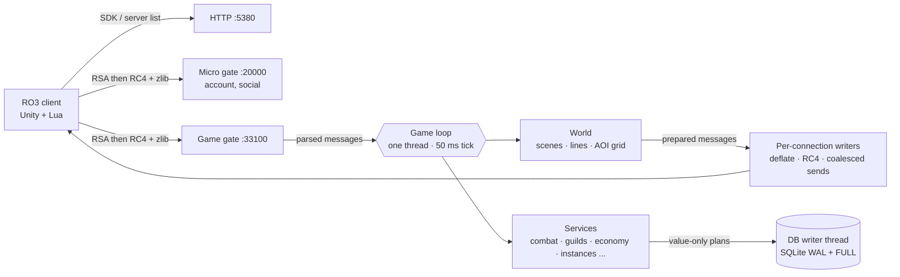

# RO3Emu: Ragnarok Online 3 server emulator

An open-source server for the **Ragnarok Online 3 PC client**, written in C# (.NET 10, SQLite). Play on your own PC,
host a server for friends, or help rebuild the original game server one system at a time. The goal is a faithful 1:1
server first; changes to the original rules come after.

<p align="center"></p>

<p align="center">
  <a href="https://github.com/aethai/ro3emu-server/releases/latest"></a>
  <a href="https://github.com/aethai/ro3emu-server/actions/workflows/tests.yml"></a>
  <a href="https://github.com/aethai/ro3emu-server/actions/workflows/ci.yml"></a>
  
  
</p>

<p align="center">
  <a href="#play-on-your-own-pc">Play</a> ·
  <a href="#play-with-friends">Play with friends</a> ·
  <a href="#what-works">What works</a> ·
  <a href="#for-developers">For developers</a> ·
  <a href="#documentation">Documentation</a> ·
  <a href="https://aethai.github.io/ro3emu-server/">Website</a> ·
  <a href="https://github.com/aethai/ro3emu-server/issues/new/choose">Report a bug</a>
</p>

---

## Play on your own PC

1. Download **`RO3Emu-win-x64.zip`** from the [latest release](https://github.com/aethai/ro3emu-server/releases/latest)
   and extract it anywhere.
2. Double-click **`RO3Emu.exe`**. Nothing to install: no .NET, Java or Node.js. If Windows says "Windows protected
   your PC" (RO3Emu is not signed), click *More info*, then *Run anyway*.
3. The first time, it finds your Ragnarok 3: Genesis game folder (or asks for the one with `ro3.exe`), prepares the
   game data it needs (about a minute), starts the server and the game. Next time it only starts the server and the
   game.
4. Log in with any account name and password: the account is created on first login. Keep the RO3Emu window open
   while you play; press **Q** there (or close it) to stop the server.

**Don't have the game?** RO3Emu.exe downloads it from the official Genesis update servers (about 24 GB) and checks every
file against the publisher's signature: it offers this when it finds no game folder, or run `RO3Emu.exe install`.
RO3Emu never hosts game files. Tested with the Genesis client releases of 7, 16 and 21 October 2026 (2026.10.21.1,
the current one); the 20 October release passes `RO3Emu.exe check` and the data export.

| Command | What it does |
|---|---|
| `RO3Emu.exe` | play on your own server (same as `RO3Emu.exe start`) |
| `RO3Emu.exe join <address>` | play on someone else's server (`host`, `host:port` or `http://host:port`) |
| `RO3Emu.exe host` | your server, open to friends (`--gm <account>` for GM commands) |
| `RO3Emu.exe install [folder]` / `update [folder]` | the game from the official servers, every file checked |
| `RO3Emu.exe restore` | undo the patch: the game talks to the official servers again |
| `RO3Emu.exe check` | does this game version fit this RO3Emu? (changes nothing) |
| `RO3Emu.exe diag` | makes `RO3Emu-diagnostics.zip` for a bug report |

**What it changes.** In the game folder: a few DLLs in `ro3_Data\Managed` (the originals are kept in `ro3emu-backup`)
and `ro3emu\loc_en.tsv` (English texts, built from your own game files). Next to RO3Emu.exe: `data\` (game data and
your characters), `logs\` and `RO3Emu.settings.json`.

> [!WARNING]
> Don't let the publisher's launcher repair a patched game folder: it puts the original DLLs back. Run RO3Emu.exe
> again and it patches the game again.

## Play with friends

**On Windows.** The host runs `RO3Emu.exe host`; it prints the address to share (Windows asks once whether the server
may use the network: allow it). Friends run `RO3Emu.exe join <that address>`. For friends outside your home network,
forward TCP ports `5380`, `20000` and `33100` on your router to the host and share your public IP. Party voice chat
is off unless the host adds `--voice-port 33101` (any free port); then forward that port too.

**On Linux.** Download **`RO3Emu-server-linux-x64.tar.gz`**, extract it and run `server.sh`; nothing to install:

```bash
./server.sh --client /path/to/ROO_PC --host <public IP> --gm <your account>     # a game folder copied from Windows
./server.sh --download /srv/ro3/ROO_PC --host <public IP> --gm <your account>   # or only the files it needs, from Genesis
./server.sh --service ...                                                       # install it as a systemd service
```

Open TCP `5380`, `20000` and `33100`, and the voice port if you turn voice on with `--voice-port 33101`.

**Good to know**
- **GM commands** (`!help` in chat) are on for every account when you play on your own PC. A hosted server gives them
  only to the accounts you name with `--gm` ([GM access](docs/guide/gm-access.md)).
- **Bug reports from players:** the Feedback button in the game menu or `/bug <text>` in chat ([feedback](docs/guide/feedback.md)).
- **Backups:** the database is backed up to `data/backups/` at start and every 6 hours (newest 20 kept).
- **One session per account:** a second login takes over from the first. The client runs one instance per PC;
  `Ro3Emu.BotCli` can stand in for extra players when you test alone.

| Hardware | Minimum | Measured target (500 players) |
|---|---|---|
| CPU | 2 cores | at most 2 cores used by the server |
| RAM | 2 GB | at most 2 GB working set |
| Disk | 3 GB plus the game | SSD recommended |

## What works

The server answers the client the way the original did: same messages, same order, same rules where the client shows
them. Rules the client cannot establish are reconstructed and marked *(inferred)* in the code and the
[system notes](docs/systems). With `Ro3Emu:OpenContent` (on by default for hosted servers) everything the client can
show is playable from day one, without season or server-day gates ([details](docs/guide/open-content.md)).

<table>
<tr><td valign="top" width="50%">

**World**
- login, server list, both gates, character create / select / delete
- maps, portals, NPCs, Kafra travel, wings, map channels
- monsters, MVPs with their summons and fields, death and revive
- silent reconnect, emotes and sitting

**Character and combat**
- skills, buffs and debuffs, damage and healing over time, auras
- crowd-control diminishing returns, energy meters, talents, job resonance
- level cap 99 with catch-up EXP, character power score
- PvP and event fights

**Items and progression**
- equipment, appraisal, affixes, enchanting, strengthening, refining
- crafting with its guarantee counters, award and choice boxes
- cards (collection stars, insert rules, Flash cards, card effects)
- Soul Echo, pets and the hatchery, mounts, wardrobe, totems, job items
- achievements, codex, Growth Classroom, Seven-Day Goal, profile card

</td><td valign="top" width="50%">

**Economy and social**
- trade center, stalls, auctions (guild, world, event), mail
- NPC, point and guild shops, battle pass
- friends and gifts, parties and raids, chat channels and horns
- party voice chat through the server (off by default, see below)
- adventure groups

**Guilds**
- management, journal, recruitment, founding, guild home
- bonfire party, caravan, black market, Ilmata challenge
- Guild League with elite rosters and capture rings
- Territory Wars and the castle siege

**Instances and activities**
- story dungeons and scripted story scenes (reconstructed)
- Spirit Tower, Phantom Realm, Valhalla Trials, Realm of the Gods
  (blessings, Final Trial honors, hall of fame), Hidden Realm
- bosses cast their special skills, with phases and summons
- Monster Hunt, Rift Crisis, Survivor Battle, Wedding Crashers,
  Dragon Coffin Island, Mock Battle (40 vs 40), Hunting Challenge,
  timed events, daily activities, leaderboards

</td></tr>
</table>

**Not yet**
- **Boss script mechanics:** the special skills are in, but mechanics that lived only in the original server's scripts
  (bubbles, bells, rhythm stages) are plain area attacks, and knockback does not move players yet.
- **Mock Battle extras:** the arena's monsters and the 40-player team frame.
- **War of Emperium extras:** commander tools, siege weapons and vehicles.
- **Survivor Battle extras:** follow, spectate, shop, Kafra adventure.
- **Guild extras:** merging, impeachment, group mail.
- **Smaller missing pieces:** shop gifting, titles, Paragon (Astral Level), and some stages of the story dungeons
  that are still simplified.
- **Tavern and guild voice:** only party voice is implemented.

**Voice.** Party voice goes through a relay in the server instead of the publisher's Tencent GME, and the patched
client records and plays it through Windows' own winmm. It is off by default: `Voice:Port` turns it on. The voice
stream is encrypted (AES-CTR with an HMAC-SHA256 tag per frame) with a fresh key per session that travels inside the
one-time ticket over the encrypted game gate, so the relay serves off loopback too.

## For developers

### Running from source

You need only the [.NET 10 SDK](https://dotnet.microsoft.com/download/dotnet/10.0). `start.cmd` builds the server, the
client DLLs and RO3Emu from source and runs RO3Emu with this repository as its home; `join.cmd <address>` does the
same for joining, and both take any RO3Emu.exe option. On Linux, `./server.sh` builds and runs the server from source.

The same steps by hand:

```bash
# game data from your client into data/ (config, scene editor, skills, nav, message table, English texts)
dotnet run --project src/Ro3Emu.Setup -c Release -- export C:\Games\ROO_PC data
# the server: HTTP 5380, micro gate 20000, game gate 33100, all on loopback; data/ holds its keys and database
dotnet run --project src/Ro3Emu.Server -c Release
# the client against it (originals kept in <client>\ro3emu-backup; "restore <client>" undoes it)
dotnet run --project src/Ro3Emu.ClientTools -- play C:\Games\ROO_PC http://127.0.0.1:5380
```

The export runs the client's own Lua bytecode in a Lua 5.4 VM and reads its file system directly
(`src/Ro3Emu.DataExport`); no decompiler is involved. To read the client's Lua yourself, `tools/LuaDecode` turns its
chunks into standard Lua 5.4 bytecode for any decompiler.

### Repository layout

| Path | What |
|---|---|
| `src/Ro3Emu.Server` | the server: HTTP, micro gate, game gate, game loop, services, SQLite stores |
| `src/Ro3Emu.Setup` | RO3Emu.exe: finds or installs the game, exports data, runs the server, patches the client |
| `src/Ro3Emu.DataExport` | game data export from the client (Lua VM, file system, nav meshes, English text map) |
| `src/Ro3Emu.ClientTools` | client patcher (patch, restore, play; the chat and voice redirects) and patch-repository releases |
| `src/Ro3Emu.ClientHooks` · `src/Ro3Emu.Loc` | code injected into the client: Lua patches, party voice and the English text layer |
| `src/Ro3Emu.Bot` · `src/Ro3Emu.BotCli` | a scripted client speaking the real protocol (tests, load, extra players) |
| `src/Ro3Emu.LoadTest` | load runner: scenarios S1-S5 with protocol bots |
| `src/Ro3Emu.Launcher` · `src/Ro3Emu.Patcher` | a player launcher and its content-addressed update engine |
| `tests/` | end-to-end tests: the server in-process, bots over real sockets |
| `tools/` | Lua, config, nav and message-table export, release scripts |
| `docs/` | guides, system notes, client research |

### Tests

```powershell
dotnet test tests/Ro3Emu.Tests -c Release --filter "Category!=Slow"   # server: real server, bots over sockets
dotnet test tests/Ro3Emu.Setup.Tests -c Release                         # RO3Emu.exe, data export, installer
dotnet test tests/Ro3Emu.Patcher.Tests -c Release                       # update engine
```

Tests of content need the exported `data/` and are skipped without it; tests of rules (persistence, retries,
ownership, logins) run on a small invented data set in `tests/Ro3Emu.Tests/Fixtures/GameData`, so CI runs them too
([docs/guide/testing.md](docs/guide/testing.md)). CI runs all three suites on Linux and Windows for every pull request and push to `main`. The suite runs as if the machine were in UTC+08, so results don't depend on where it runs
(`RO3EMU_TEST_HOST_TZ=<zone id>` picks another zone, `host` keeps the real one).

### Load tests

```powershell
dotnet run -c Release --project src/Ro3Emu.LoadTest -- --scenario S2 --server-local --bots 300 --duration-seconds 600 --output .loadtest/s2
```

S1 is a login storm (500 logins in 60 s), S2 300 players in one town, S3 500 players in a mixed economy with a ledger
check, S4 map changes and relogs, S5 a full castle siege (two guilds of 80). Each report marks every target (tick p99,
reply latency, login time, players per view, database work on the loop, GC, CPU, memory) as PASS, FAIL or NOT MEASURED
with the evidence.

### Releases

`pwsh tools/release/pack.ps1` builds both archives (self-contained, single file) and fails if anything from the game
would ship. `pwsh tools/release/smoke.ps1` then tests the zip as a stranger would: a fresh folder, a copy of the
client, no .NET, Java or Node on the PATH, export, server, patch, a bot logging in, join, restore. CI has no game
client, so a tag build uses the committed `prebuilt/client` DLLs: refresh them with
`pack.ps1 -UpdatePrebuiltClientDlls` whenever `src/Ro3Emu.ClientHooks` or `src/Ro3Emu.Loc` change.

### Architecture



- **One game loop** owns all game state on a 50 ms tick; network readers only parse and queue, so services need no
  locks of their own.
- **Persistence off the loop:** stores hand immutable plans to a single writer thread, one transaction per plan.
  Activity rewards are settled through durable payout obligations ([docs](docs/systems/durable-settlement.md)).
- **Visibility:** a grid per scene, views capped at the client's own limit, nearest players first; broadcasts are
  serialized once and shared.
- **Map lines:** busy public maps open more channels and close empty ones.
- **Metrics:** `/ro3emu/metrics` (loopback only) shows tick, queue and per-message costs and database work by call
  site.

### Contributing

Issues and pull requests are welcome. [CONTRIBUTING.md](CONTRIBUTING.md) covers the build checks, the evidence rules and
what to include in a report or a change. Thanks to everyone who has sent fixes so far.
Report a security issue privately, as [SECURITY.md](SECURITY.md) describes.

## Documentation

- [`docs/guide/`](docs/guide): running a server (GM access, open content, feedback, launcher)
- [`docs/systems/`](docs/systems): how each system works and which rules are inferred
- [`docs/research/`](docs/research): the client evidence behind the protocol and rules

## License

RO3Emu is free software under the [GNU General Public License v3.0](LICENSE).

## Disclaimer

RO3Emu is an independent research and interoperability project. It is not affiliated with or endorsed by Gravity or
any publisher of Ragnarok Online. It does not include or distribute the game client, its data or its art; you need your
own copy, and you are responsible for using it in line with the applicable laws and license terms. Ragnarok Online is a
trademark of Gravity Co., Ltd.
