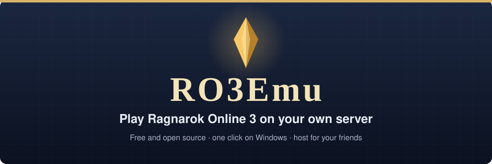
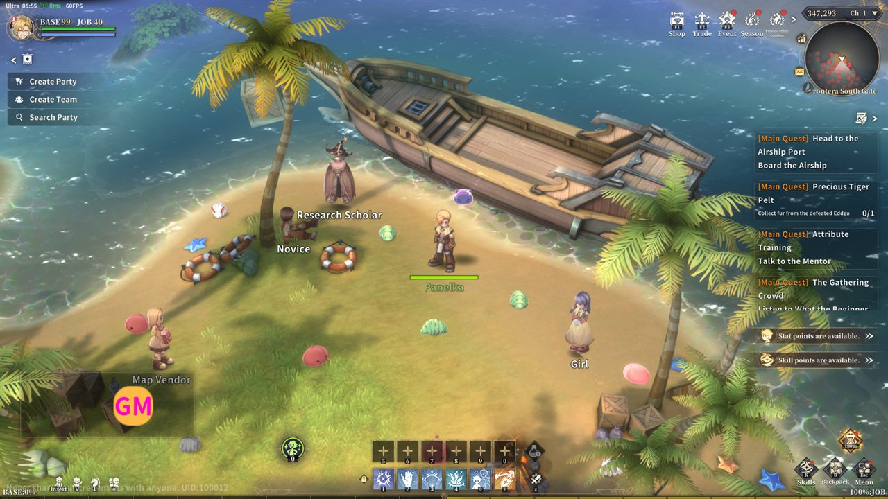
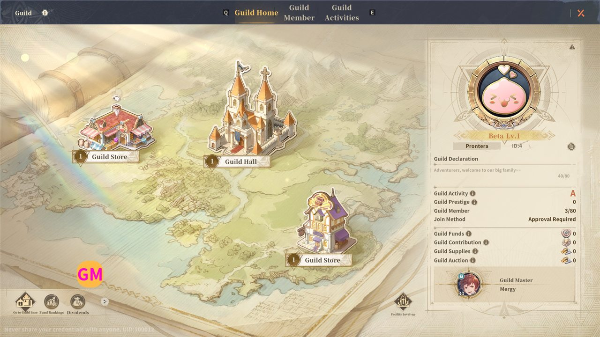
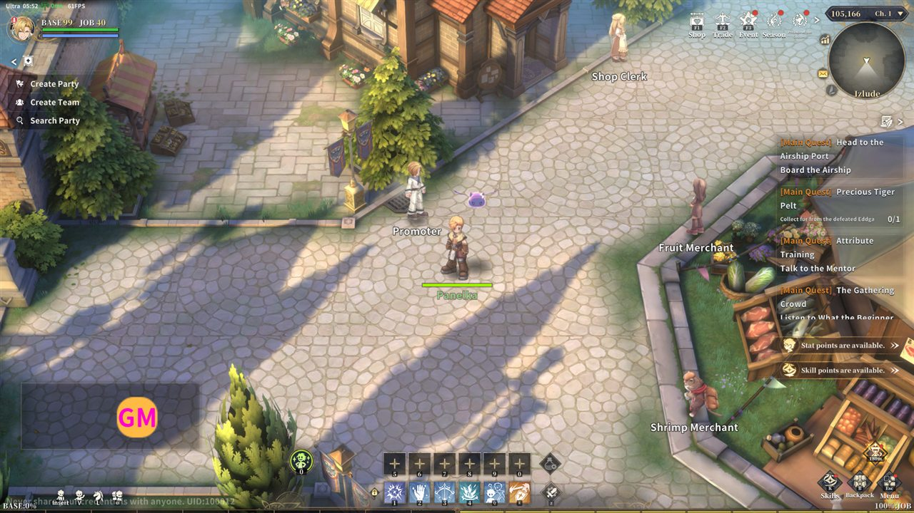
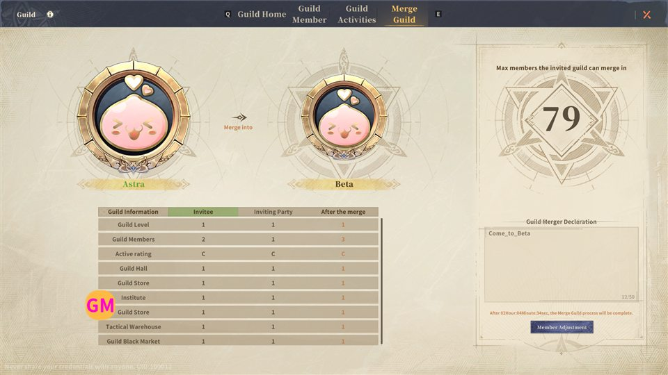
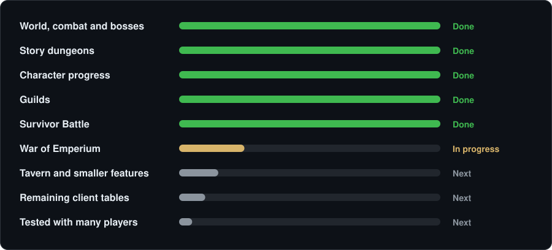

  

  
  &nbsp;
  
  &nbsp;
  

  
  
  
  
  

<table>
  <tr>
    <td width="50%"> Explore the world: maps, monsters and MVPs</td>
    <td width="50%"> Build a guild and its home</td>
  </tr>
  <tr>
    <td width="50%"> Towns full of NPCs, merchants and quests</td>
    <td width="50%"> Every window of the original client works</td>
  </tr>
</table>

Screenshots: the unmodified game client on an RO3Emu server.

## Why RO3Emu

<table>
  <tr>
    <td width="50%" valign="top"><b>The original game, faithfully</b> The server answers the client the way the original did. Where nobody knows how something worked, it is a best guess, and marked as one.</td>
    <td width="50%" valign="top"><b>One click to play</b> A single <code>RO3Emu.exe</code>, nothing to install. It finds your game, prepares it and starts both the server and the game.</td>
  </tr>
  <tr>
    <td width="50%" valign="top"><b>Your own game files</b> We never host the game. No game yet? RO3Emu downloads it from Genesis' update servers and checks every file's signature.</td>
    <td width="50%" valign="top"><b>Play together</b> Host for your friends from Windows or a Linux box, with party voice chat. Built for hundreds of players on two cores.</td>
  </tr>
</table>

## Start in three steps

| | |
|:---:|---|
| **1** | **Download** `RO3Emu-win-x64.zip` from the [latest release](https://github.com/aethai/ro3emu-server/releases/latest) and extract it anywhere. |
| **2** | **Run `RO3Emu.exe`.** It finds your Ragnarok 3: Genesis folder, or offers to download the game (about 24 GB). |
| **3** | **Log in and play** with any account name and password: the account is created on your first login. |

> [!TIP]
> Windows says "protected your PC"? RO3Emu is not signed: click **More info**, then **Run anyway**.
> More in the [full guide](docs/guide/play.md): every command, what RO3Emu changes in the game folder, and how to undo it.

## Play with friends

| You host | Your friends join |
|---|---|
| `RO3Emu.exe host` | `RO3Emu.exe join <address>` |
| It prints the address to share. Outside your home network, forward TCP 5380, 20000 and 33100. | That's all: the game is patched for your server and starts. |

Hosting on Linux, a VPS or a home server? One script, nothing to install: see [hosting](docs/guide/hosting.md).

## What works today

Everything the client can show is playable from day one, without season gates. The full list is in
[What works](docs/features.md), and each release lists what is new in its [release notes](https://github.com/aethai/ro3emu-server/releases).

## Community

RO3Emu is built in the open. Thank you to everyone who sends fixes and reports bugs.

- **Found a bug?** [Open an issue](https://github.com/aethai/ro3emu-server/issues/new/choose), or use the Feedback button in the game menu on a hosted server.
- **Questions, or hosting a server?** Ask on [Discord](https://discord.gg/vVkcvMFKy3).
- **Want to help?** Read [CONTRIBUTING.md](CONTRIBUTING.md) and the [developer guide](docs/development.md).

**Community projects** (maintained outside this repository, by their authors):

- [ro3-cpanel](https://github.com/soyerno/ro3-cpanel): a web control panel for server operators (accounts, characters, economy log, GM tools).
- [ro3-emu-launcher](https://github.com/soyerno/ro3-emu-launcher): a desktop launcher with auto-patching, separate from `src/Ro3Emu.Launcher`.

<b>For developers</b>

- [Running from source](docs/development.md#running-from-source): the .NET 10 SDK and `scripts\start.cmd`
- [Repository layout and architecture](docs/development.md#repository-layout)
- [Tests and load tests](docs/development.md#tests)
- [System notes](docs/systems) and [client research](docs/research)
- [Contributing](CONTRIBUTING.md) and [security](SECURITY.md)

---

RO3Emu is free software under the [GNU General Public License v3.0](LICENSE). It is an independent research and
interoperability project, not affiliated with or endorsed by Gravity or any publisher of Ragnarok Online. It does not
include or distribute the game client, its data or its art; you need your own copy, and you are responsible for using it
in line with the applicable laws and license terms. Ragnarok Online is a trademark of Gravity Co., Ltd.
