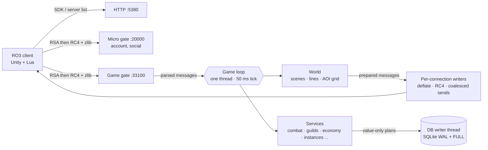

# For developers

## Running from source

You need only the [.NET 10 SDK](https://dotnet.microsoft.com/download/dotnet/10.0). `scripts\start.cmd` builds the server, the
client DLLs and RO3Emu from source and runs RO3Emu with this repository as its home; `scripts\join.cmd <address>` does the
same for joining, and both take any RO3Emu.exe option. On Linux, `scripts/server.sh` builds and runs the server from source.

The same steps by hand:

```bash
# game data from your client into data/ (config, scene editor, skills, nav, message table, English texts)
dotnet run --project src/Ro3Emu.Setup -c Release -- export C:\Games\ROO_PC data
# the server: HTTP 5380, micro gate 20000, game gate 33100, all on loopback; data/ holds its keys and database
dotnet run --project src/Ro3Emu.Server -c Release
# the client against it (originals kept in <client>\ro3emu-backup; "restore <client>" undoes it)
dotnet run --project src/Ro3Emu.ClientTools -- play C:\Games\ROO_PC http://127.0.0.1:5380
```

The export runs the client's own Lua bytecode in a Lua 5.4 VM and reads its file system directly
(`src/Ro3Emu.DataExport`); no decompiler is involved. To read the client's Lua yourself, `tools/LuaDecode` turns its
chunks into standard Lua 5.4 bytecode for any decompiler.

## Repository layout

| Path | What |
|---|---|
| `src/Ro3Emu.Server` | the server: HTTP, micro gate, game gate, game loop, services, SQLite stores |
| `src/Ro3Emu.Setup` | RO3Emu.exe: finds or installs the game, exports data, runs the server, patches the client |
| `src/Ro3Emu.DataExport` | game data export from the client (Lua VM, file system, nav meshes, English text map) |
| `src/Ro3Emu.ClientTools` | client patcher (patch, restore, play; the chat and voice redirects) and patch-repository releases |
| `src/Ro3Emu.ClientHooks` · `src/Ro3Emu.Loc` | code injected into the client: Lua patches, party voice and the English text layer |
| `src/Ro3Emu.Bot` · `src/Ro3Emu.BotCli` | a scripted client speaking the real protocol (tests, load, extra players) |
| `src/Ro3Emu.LoadTest` | load runner: scenarios S1-S5 with protocol bots |
| `src/Ro3Emu.Launcher` · `src/Ro3Emu.Patcher` | a player launcher and its content-addressed update engine |
| `tests/` | end-to-end tests: the server in-process, bots over real sockets |
| `tools/` | Lua, config, nav and message-table export, release scripts |
| `docs/` | guides, system notes, client research |

## Tests

```powershell
dotnet test tests/Ro3Emu.Tests -c Release --filter "Category!=Slow"   # server: real server, bots over sockets
dotnet test tests/Ro3Emu.Setup.Tests -c Release                         # RO3Emu.exe, data export, installer
dotnet test tests/Ro3Emu.Patcher.Tests -c Release                       # update engine
```

Tests of content need the exported `data/` and are skipped without it; tests of rules (persistence, retries,
ownership, logins) run on a small invented data set in `tests/Ro3Emu.Tests/Fixtures/GameData`, so CI runs them too
([docs/guide/testing.md](guide/testing.md)). CI runs all three suites on Linux and Windows for every pull request and push to `main`. The suite runs as if the machine were in UTC+08, so results don't depend on where it runs
(`RO3EMU_TEST_HOST_TZ=<zone id>` picks another zone, `host` keeps the real one).

## Load tests

```powershell
dotnet run -c Release --project src/Ro3Emu.LoadTest -- --scenario S2 --server-local --bots 300 --duration-seconds 600 --output .loadtest/s2
```

S1 is a login storm (500 logins in 60 s), S2 300 players in one town, S3 500 players in a mixed economy with a ledger
check, S4 map changes and relogs, S5 a full castle siege (two guilds of 80). Each report marks every target (tick p99,
reply latency, login time, players per view, database work on the loop, GC, CPU, memory) as PASS, FAIL or NOT MEASURED
with the evidence.

## Releases

`pwsh tools/release/pack.ps1` builds both archives (self-contained, single file) and fails if anything from the game
would ship. `pwsh tools/release/smoke.ps1` then tests the zip as a stranger would: a fresh folder, a copy of the
client, no .NET, Java or Node on the PATH, export, server, patch, a bot logging in, join, restore. CI has no game
client, so a tag build uses the committed `prebuilt/client` DLLs: refresh them with
`pack.ps1 -UpdatePrebuiltClientDlls` whenever `src/Ro3Emu.ClientHooks` or `src/Ro3Emu.Loc` change.

## Architecture



- **One game loop** owns all game state on a 50 ms tick; network readers only parse and queue, so services need no
  locks of their own.
- **Persistence off the loop:** stores hand immutable plans to a single writer thread, one transaction per plan.
  Activity rewards are settled through durable payout obligations ([docs](systems/durable-settlement.md)).
- **Visibility:** a grid per scene, views capped at the client's own limit, nearest players first; broadcasts are
  serialized once and shared.
- **Map lines:** busy public maps open more channels and close empty ones.
- **Metrics:** `/ro3emu/metrics` (loopback only) shows tick, queue and per-message costs and database work by call
  site.

## Contributing

Issues and pull requests are welcome. [CONTRIBUTING.md](../CONTRIBUTING.md) covers the build checks, the evidence rules and
what to include in a report or a change. Thanks to everyone who has sent fixes so far.
Report a security issue privately, as [SECURITY.md](../SECURITY.md) describes.
