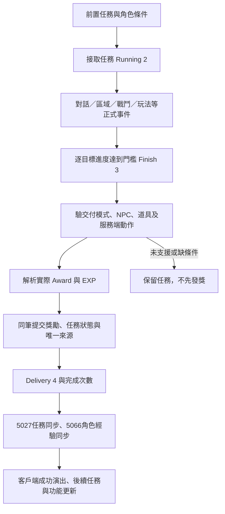

# G 任務全流程與 Base／Job 經驗值分配

本頁說明 2026-10-30 對 `G:\RO3 Asia Launcher` 的靜態逆向、完整設定列舉與重建伺服器之比較。第一至六節保留同步前基底 `5526138` 的研究世代；第七節列出整合 v1.0.21 後重新驗證的差異。保留上一輪飛船修改，未推送或部署。玩家已選擇先完成 LAB、稍後自行驗收。

## 來源與 REA／IDA 的實際覆蓋

G 的 `RECONSTRUCTED_PAYLOAD_BUILD_EVIDENCE.json` 標示 `ReconstructedPayload`；設定 overlay 宣告 `derived_release_config_snapshot`，未提供原廠伺服器來源。下列是目前 G 檔案能證實的契約，不能把重建 C#、設定預覽或 IDA 符號當作原服發獎實作。

- REA 重新靜態解析 G `Assembly-CSharp.dll`：SHA-256 `4365BCCF…0602E11`，MVID `e110a0b2-21ac-4fc3-a019-467cdaaaa9a1`。`LA_LuaLoader.Obf_HD` 的 IL offset 202 呼叫 `HappyEngine.Runtime.NewRuntimeSystem.NewResourceManager.LoadLuaBytesFromFile`。這證明檔案讀取邊界，不是任務 EXP 公式。
- REA／IDA 對 G `xlua.dll`（SHA-256 `C189E0FD…FC7309A`）取得 `0x180031930` 的指令載入解碼及 `0x1800317A0` 的逆向 XOR 字串轉換偽碼，與既有靜態 normalizer 的對應步驟相符。IDA adapter 未提供完整函式 body ranges、typed xrefs、CFG、indirect-call 或 value-flow，未聲稱分析完整個 native 程式。
- 本輪重新正規化、反編譯 G 的 Task／Award／MultiverseGroup 三份 CFG，全部 return code 0、輸出逐位元等於已保存解碼副本、G 原件前後雜湊不變。這是靜態重現，runtime 等價仍未實測。
- 任務目錄 20 份設定來源、額外 Lua 流程／缺口來源及發獎消費端皆有當前雜湊綁定。完整原始收據在 `D:\RO3 Asia Launcher\Quest-Flow-EXP-G-Audit-20261030`，REA 證據匯出包含 14 筆記錄。

## 一、完整任務目錄與處理器覆蓋

| 項目 | 本輪結果 | 能證明的範圍 |
|---|---:|---|
| TaskConfig | 1072 筆、25 種 type | 全設定列，與工作樹逐列相同，沒有缺 G 任務列。 |
| 任務相關表盤點 | 15 個名稱候選表、1396 列 | 其中 7 個任務／追蹤家族、4 個中繼表；3 個問答表及 GuildPermission 名稱誤命中已另分，沒有冒充任務數。 |
| 目標 | 1118 列、136 種代碼 | 保存每筆原始參數形狀、門檻、程式引用與保留理由。 |
| 目前引擎目標判定 | 918／1072 可解析 | 實際呼叫目前 TaskService 的判定，沒有完成任務或發獎。 |
| 接受動作判定 | 1072／1072 | 只驗既有動作解析；不代表前置、角色條件及活動入口都成立。 |
| 交付計畫 | 1018／1072 | 不建立資料庫或入帳；空白 LAB 角色不代表有道具、NPC 距離或活動資格。 |
| 三項同時支援 | 917／1072 | 是處理器／規劃覆蓋率，不能當作 917 個任務玩家通關。 |
| 探針例外 | 0 | 已綁定目前建置、來源與匯出雜湊；沒有網路、資料庫或獎勵提交。 |

目標保留共有 154 筆任務：152 筆含 155 個保留目標欄位，另 2 筆沒有目標。155 個欄位分成 40 種代碼／114 個完整形狀：151 個未支援門檻形狀、2 個提交模式、2 個尚無 Tavern／event producer。交付另保留 53 筆 action 116 `UpdateSocialityScore` 與舊任務 `102030` 的 action 410 `CheckMainQuestBranch`。去除重疊後，合併保留 155 筆任務，不能把各種單位直接相加。

主要群組為 `107005×31`、`210005×25`、`106012×20`、`101021/NowMount×12`。`210004/CheckDungeonKillBossId` 與 `200003/CheckTargetWeakness` 已追到 G 描述格式函式，但描述函式只證明顯示門檻，沒有證明應由哪個耐久事件完成它。沒有把這些目標空放行、自動補完成或補發獎勵。

主根 `10101010` 的前置圖有 202 個節點；593 條全目錄前置關係中，59 條指向 G 本身缺少的 `999999/9999999/99999999`。這些 sentinel 不直接補造，也不刪除前置。479 筆無前置任務仍可能由活動或其他 owner 指派，不能只看圖就宣稱不可達。

## 二、接取到下一任務的完整狀態鏈

G `LC_TaskHelper.DealAcception` 依目前目標的 action slot 執行接受動作；`DealSuccess` 執行成功動作；Client／All host 的動作才在客戶端執行。Server-host 的資源、計分及交易語義要由伺服器實作，不能只發一個成功回應代替。

| 協定 | G 用途與檢查重點 |
|---|---|
| `5027 / DBTaskInfo` | 任務狀態、各目標 `completeNum`、歷史完成次數；狀態 0 None、1 CanAccept、2 Running、3 Finish、4 Delivery、5 Fail。 |
| `31202 / 31203 / 31204 / 31205` | 接取、放棄、重設、交付；完成回應本身沒有 Base／Job 數量。 |
| `31208 / 31209 / 31214` | 對話、區域與客戶端互動回報；須驗任務、場景、目標與事件來源，不能當作任意增加計數 API。 |
| `84011` | 合法故事片尾；`84012` 是另一種觸發事件，不能偽帶片尾 ID 冒領飛船通關。 |
| `32709` | 退出過場狀態，不自行完成故事目標或發獎。 |
| `5066 / RoleBaseInfoIncrement` | `level/jobLevel/exp/jobExp` 的角色權威同步；真正 Base／Job 入帳應比較此資料與資料庫／重登入帳。 |

目前任務來源 `task/role/taskId/count/epoch` 綁定交付次數與日／週世代。獎勵與任務快照先提交，再呈現；重送不建立第二份來源。上一輪貨物最後關已改成目標完成與獎勵同筆提交，避免 G 以 `CompleteNum+1` 重開不存在的第四關。副本通關到任務交付則以既有持久化義務銜接，不能把「看到通關畫面」當成任務已入帳。

## 三、任務 Base／Job 經驗來源

本輪對每個任務的預設與季節玩法路徑完整展開，G 與目前工作樹各 **5056 條**，未解析路徑 **0**。Task／Award／MultiverseGroup／DropPool／DropGroup／Item 六張表逐列相同。

| 來源 | 結果 | 解讀 |
|---|---:|---|
| `TaskConfig._kEXP=[1,amount]` | 358 筆 | 現行重建程式解為任務 Base EXP；G 已查 consumer 沒有原服數值計算式。 |
| `_kEXP` 空值 | 714 筆 | 仍須沿實際獎勵群組／掉落池查，不表示一定無獎勵。 |
| 實際掉落池 Base 候選 | 27 筆任務、216 條玩法路徑 | 隱式 3000..3999 EXP 曲線；依條件、權重與角色等級解析，候選不等於每次固定取得。 |
| 與 `_kEXP` 重疊 | 4 筆 | `3004/3008/3014/3018`；目前兩路各套 Base 倍率後相加。原服是加總或其他政策仍需實發證據，沒有擅刪一路。 |
| 任一設定 Base 路徑 | 381 筆 | 其餘 691 筆目前沒有可見設定 Base 路徑；這不是所有角色實際入帳結果。 |
| Task type 2／實際 item 101 終端 | 0 | 不能因此宣稱原服任務都不給 Job，也不能據此補 `Job=Base`。 |
| Base／Job 預覽圖示 | 222 筆任務 | 每筆固定 `[100,1]`、`[101,1]`，不同於任務實際 Base 數量。 |

實際獎勵鏈是 `_iAward → MultiverseGroupConfig（季節值非零優先，否則 default）→ AwardConfig._kAward／_iDropPool → DropGroup`。預覽另走 `_kPreview／_kSpecialPreview`。G 的 Award CFG、TaskWidget、ItemHelper 將上述 `1` 當 `iCount` 傳遞，已查路徑未將它換成經驗量／百分比；最終特殊遮罩仍未驗收。預覽不能作為發獎來源。

現行 `CharacterService.ApplyAward` 分別累加虛擬物品 100（Base）與 101（Job），使用 long 計算、依各自倍率與等級需求處理，並提交角色進度、物品與任務來源。此終端已有 Job 支援；目前缺的是原服任務 Job 如何定量的證據。

升級、免費 Job 等級、滿等截留與 Base 轉 Paragon 必須分開計算。角色 Job 等級變動不等於這個任務發了 Job EXP；只比較剩餘 exp 也會漏算升級已消耗量。任務／郵件目前不套擊殺的世界等級追趕政策，原服是否相同仍 UNKNOWN。

## 四、組隊擊殺經驗分配

G 的 `TeamExpBuffNum=[10000,12500,15000,17500,20000]` 與目前提示文字對應 1–5 人級距；40 人團的 UI 依五席分組。UI 計數沒有檢距離、死亡或貢獻。`GetMemberOnlineState` 使用 `RoleFOVMax` 換算的 55 m 標作 Faraway；未找到將此顯示狀態用作 EXP 排除的呼叫鏈，`TeamAloofLimit=50` 也沒有證實是 EXP 半徑。

現行伺服器採以下 **inferred 政策**，並非原服公式驗收：

1. 只在公共野外、同一 runtime 場景及同一五席組內選角色；須有載入完成、未取消的角色 attachment。不同地圖、分線或副本不共享。完整登出者不列入；grace／TransportLost 仍保留 attachment 的情況沒有額外 EXP 排除條件。
2. 同圖遠距、死亡及未傷害隊友沒有額外排除；不依隊長或最後一擊隊友另加權。角色在擊殺時已凍結為收件人，之後斷線仍可重登領取已建立的持久化義務。
3. 掉落 Base 候選先按擊殺者與怪物的等差修正，再乘組隊級距。Base 另套擊殺者的追趕加成；Job 使用追趕之前的 Base 值。最後分別套 Base／Job 伺服器倍率。
4. 各自的 Base／Job 池整除合格人數，餘數依席位順序補 1；擊殺者當筆入帳，其他角色各建一筆唯一義務。原服是否平分、使用哪個分母及逐人等差修正，均 UNKNOWN。

假設沒有等差／追趕／伺服器倍率差異、原始池為 100，目前本地政策為：

| 合格人數 | G 設定級距 | 本地池 | 席位分配 |
|---:|---:|---:|---|
| 1 | 10000 | 100 | 100 |
| 2 | 12500 | 125 | 63、62 |
| 3 | 15000 | 150 | 50、50、50 |
| 4 | 17500 | 175 | 44、44、44、43 |
| 5 | 20000 | 200 | 40、40、40、40、40 |

這張表只是目前模擬器算式示例，不是原服實測數值。G `LvExpCorrectionConfig` 的 401 列另外有絕對等差 0..5／6..10／11..15／16..200 的 10000／7000／4000／1000 級距；原服是否對每名隊友分別套用不能由這張表證明。

## 五、本輪可證實修正與驗證

已重現：`TeamService` 原本以靜態陣列寫死五個倍率，沒有讀 `PublicParamConfig.TeamExpBuffNum`。自造資料設三人倍率 17000 時仍使用 15000，7 EXP 得到池 10／`[4,3,3]`，沒有遵守載入的設定。

本輪改由異質參數表的具名型別讀取器讀取五個非負 int32 級距，存於該 host 的 TeamService。缺參數時使用中性 10000 為本地 fallback 政策；有參數但形狀／型別錯誤則明確拒絕。G 目前五個值與舊陣列相同，沒有藉此改猜原服分母、距離、Job 比率或任務獎勵。

新增合成整合案不使用 `ResolveKillForTest`：自造 NPC→Multiverse→NPCDrop→100% DropPool→隱式 EXP 曲線 7，三人倍率刻意設 17000，要求 Base／Job 各為池 11／席位 `[4,4,3]`，核對三角色 DB、5066、兩筆義務與同來源重送。此案直接在 LAB 呼叫正式獎勵管線，沒有模擬玩家技能輸入或真正原生客戶端擊殺。修正前失敗收據已保存。

本輪最終建置、測試與格式結果另列於 LAB `README.md`、`final-result.json` 及原始 TRX。上一輪 23 個異動檔在本輪開始時雜湊全部相同；本輪新增的變更另有清單，沒有覆蓋飛船修正。

## 六、尚待驗收的範圍

- 全 1072 筆任務的實際可達性、完成、動畫、跳過與玩家畫面仍未全跑；處理器覆蓋率不能代替遊玩結果。飛船逐項結果沿用 `airship-full-flow-evidence.md`。
- 原服任務 Job 數量、組隊分母／距離／死亡／貢獻／等差規則仍 UNKNOWN。原服同角色前後與重登入帳，以及逐隊員 5066 樣本，才是後續定量驗收 gate。
- action116 社交計分、action410 舊主線分支及 40 群保留目標需先綁定正確 owner／事件／交易，不能以無條件完成補齊。
- 一般虛擬 EXP grant 的 int32 倍率截斷有合成未來配置候選，但目前 G 任務數值在允許倍率內不會觸發；沒有把它當成目前玩家漏 EXP 的原因，也未擴大修改該路徑。
- 本輪不啟動 G 原服、不推送、不新增發行、不部署。玩家端驗收由使用者稍後執行，狀態為 NOT_RUN。

## 七、v1.0.21 整合後的獨立驗證

依使用者「原專案已有修正，以原專案為主」的指示，整合上游 `9d2d6be50ca1abc0e4c3388cd32375394d471e1d`；本地合併提交為 `cbe43491fc24f9974de7733b6bc015762d129002`，先前飛船與組隊修正另保留為工作樹異動。原 catalog 與 probe 不覆寫，新收據存於 LAB 的 `post-v1021-root-tasks/`。

| 重新執行的引擎判定 | 同步前 | 整合後 |
|---|---:|---:|
| 同一組任務 ID | 1072 | 1072 |
| 目標可解析 | 918 | 923 |
| 接取 action 可解析 | 1072 | 1072 |
| 交付計畫可解析 | 1018 | 1018 |
| 上述三項同時成立 | 917 | 922 |
| 交付探針例外 | 0 | 0 |

519 份匯出設定表的新舊雜湊完全相同。差異只有 21 筆新增 `AcceptRootTasks` 接取 owner，以及任務 120001–120005 的 `106610` 戰功目標改由上游 BattleMerit 處理器判定。未支援目標的任務由 154 降為 149；這不是 5 筆玩家實際完成。任務 `10200120` 的 `[210006,1]` 仍未支援，不能因新增接取入口而宣稱可完成。

虎王退場採上游共用 `PlaneExit`，成功後 5 秒走正常 30402 離場，移除本地另一份 3 秒排程。這個時間是上游推定政策，並非原服錄影驗收。飛船的貨物最後一關原子交付、片尾／自訂傳送驗證與重連恢復仍保留。上游尚無等價的多人持久化 EXP 義務流程；本地組隊入帳修正繼續保留，原服距離／Job 公式仍 UNKNOWN。

候選 Server、Tests、QuestCoverage 使用相同 Server DLL：SHA-256 `1c9bd059ce4349497ca55a09bd26d3f2040959130d5fe677b24aa5ba808f10e6`。24 份任務來源與新 probe 雜湊相符；建置前 epoch 中過期的 `TaskService.cs` 雜湊保留為歷史，沒有拿來冒充最終來源。

整合後伺服器完整回歸共 2312 項，原始一次執行為 2311 通過、1 項因隔離工作樹缺少 ignored Lua 證據失敗。補入來源／輸出雜湊相符的兩份證據檔後，該項原碼不變重測通過。配套工具另 188 項通過；合計 2500 個不同案例均有通過紀錄，未重複計數。原始失敗與重測 TRX 均保留於同步 LAB。玩家畫面、原服流程與全任務實際遊玩仍為 NOT_RUN。
